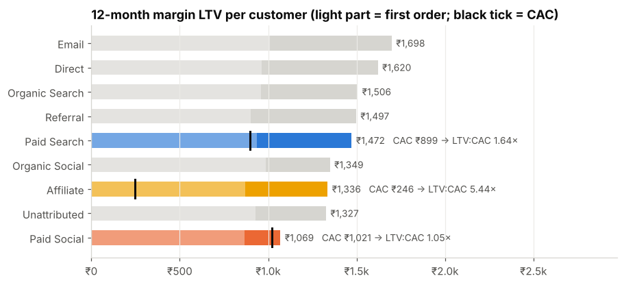
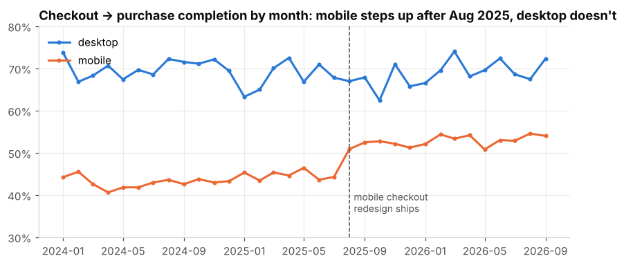
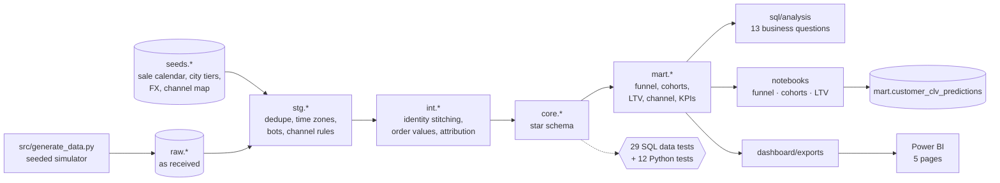
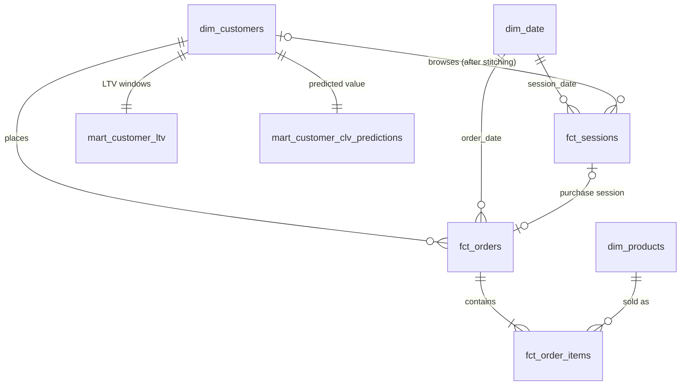

# E-commerce Funnel, Cohort & LTV Analysis

**Do the channels that bring the most customers also bring the most valuable ones, and if not, what should we spend, fix and retain differently?**

An end-to-end growth analytics project for *Threadline*, a fictional Indian D2C apparel brand: raw event and order data → data-quality audit → tested SQL data model → funnel, cohort and LTV analysis → Power BI dashboard → prioritised recommendations.

> ⚠️ **The data is synthetic** and generated by a documented, benchmark-calibrated simulator ([why and how](docs/generator_assumptions.md)). Findings demonstrate the *methods*. Because the ground truth is known, the project also shows that the methods recover it (e.g. the diff-in-diff estimate of a checkout redesign is +9.6 pp against a true +8 pp).

**Stack:** SQL (DuckDB) · Python (pandas, SciPy, matplotlib) · Power BI · git. Plain layered SQL is used instead of dbt so the project has no extra tooling.

---

## Key findings (last 12 months unless stated)

| | Finding | Evidence |
|---|---|---|
| 1 | **Paid Social buys volume, not value.** Largest acquisition channel (29% of customers) with the lowest quality | Repeat within 12 months 16.6% vs 31.2% (Paid Search); 12-month margin LTV ₹1,069 vs ₹1,473; **LTV:CAC 1.05× vs 1.64×** |
| 2 | **The 2025 Meta spend increase hit diminishing returns** | Spend ×2.2, CPC +33%; **marginal CAC ₹1,250 > ₹1,069** that a Paid Social customer earns in 12-month margin |
| 3 | **Mobile checkout is the highest-value funnel fix** | Mobile checkout→purchase 53% vs desktop 69%; Aug-2025 redesign **+9.6 pp (95% CI 6.6–12.7)** via diff-in-diff; a further +4 pp ≈ ₹13L net revenue a year (scenario) |
| 4 | **Blended retention hides a mix shift** | More Paid Social in the mix keeps blended 90-day repeat flat; mix-adjusted cohorts would repeat 0.4–0.6 pp more |
| 5 | **Discount-led acquisition creates low-value customers** | Sale-acquired customers ₹649 vs ₹1,521 12-month margin; a first-order return cuts repeat 29% → 22% |

Full write-up with Observation → Evidence → Why it matters → Implication → Action, an opportunity matrix, data gaps and risks: **[docs/insights_and_recommendations.md](docs/insights_and_recommendations.md)**.

<p align="center"> </p>

---

## 1. Business problem

| Stakeholder | Decision this analysis supports |
|---|---|
| VP Growth / CMO | How to reallocate the acquisition budget across channels |
| Performance Marketing | Maximum CAC bid per channel; whether the Meta scale-up paid off |
| CRM / Retention | Whether and when to run a second-purchase programme, and for whom |
| Product / CRO | Which funnel stage and device to prioritise |
| Finance | Whether margin-based LTV justifies current growth spend |

Customer journey: *ad / search / direct visit → sessions → product view → add to cart → checkout → purchase (COD or prepaid) → delivery or RTO → return or keep → repeat purchase or silent churn.*

## 2. Dataset

Six raw sources mimicking what an analyst actually receives: a **UTC event log** with raw UTM strings (~4M events), an **orders table in local time** with duplicate rows and messy status values, order lines, users (including internal QA accounts), products with unit cost, and **ad-platform spend exports** (one week mistakenly in USD). Jan 2024 – Sep 2026; 820k visitors, 1.14M sessions, 33.5k orders, 20.3k customers.
→ [Generator & calibration](docs/generator_assumptions.md) · [Data dictionary](docs/data_dictionary.md)

## 3. Architecture



## 4. Data model



| Table | Grain | Key fields derived |
|---|---|---|
| `fct_sessions` | one non-bot session | channel (ordered UTM/referrer rules), visitor type, funnel stage flags ("reached stage or later") |
| `fct_orders` | one real order | valid flag, net revenue, gross margin, customer order number, last-click channel, first-touch channel |
| `fct_order_items` | one order line | gross/returned/net revenue, COGS, margin |
| `dim_customers` | one registered user | first-touch acquisition channel, cohort month, first-order attributes, value to date |
| `dim_products`, `dim_date` | product / day | margin %, sale calendar, complete-month flag |

Two fact grains are intentional: funnel questions live at the session level and revenue questions at the order level. They connect through the purchase session.

## 5. Methodology

**Data quality ([report](docs/data_quality_report.md), [notebook 01](notebooks/01_data_profiling.ipynb)).** 14 issues, each detected → explained → decided → tested: duplicate events (2 kinds), duplicate order rows, **UTC vs IST time zones**, clock skew, **bots** (behavioural rule; user-agent alone misses 59%), **messy UTMs** (Meta `cpc` ≠ Paid Search), anonymous events (**identity stitching**), internal QA orders, status casing, an `order_total` bug, **untracked orders** (4.4%, labelled `Unattributed`, not Direct), Buy-Now purchases skipping the cart, **USD-denominated spend**, and in-flight orders.

**SQL analysis ([sql/analysis](sql/analysis)).** 13 queries, each headed by the business question it answers and the decision it supports, ordered from basic to advanced:

| File | Question | Techniques |
|---|---|---|
| 01 | Size and health of the business | conditional aggregation, CASE |
| 02 | Conversion by channel × device | ROLLUP, FILTER |
| 03 | Trend net of seasonality | LAG, rolling windows, YoY |
| 04 | Funnel stages and drop-off | UNPIVOT, LAG, FIRST_VALUE |
| 05 | Did the checkout redesign work? | difference-in-differences, standard errors |
| 06 | Retention matrix | cohort assignment, PIVOT |
| 07 | LTV, CAC, LTV:CAC, payback by channel | multi-CTE, cumulative windows |
| 08 | Marginal vs average CAC of the Meta ramp | period comparison, marginal metrics |
| 09 | Value concentration | NTILE, percentiles, cumulative share |
| 10 | COD / RTO economics by city tier | multi-grain joins |
| 11 | Time to second purchase | percentiles, survival-style shares |
| 12 | First category vs LTV | RANK, HAVING, vs-average |
| 13 | Cohort mix shift | weighted vs mix-adjusted averages |

**Funnel ([notebook 02](notebooks/02_funnel_analysis.ipynb)).** Session-level, monotonic stages; Wilson CIs; chi-square across channels; diff-in-diff with a parallel-trends check; opportunity sizing as explicit scenarios (upper bound, then realistic improvements with stated assumptions).

**Cohorts ([notebook 03](notebooks/03_cohort_retention.ipynb)).** Cohort = month of first *valid* order. Monthly retention triangle (observable months only), cumulative repeat curves, cohort revenue curves, a mix-shift decomposition, and segment drivers (sale-acquired, first-order returns, COD, tier, device).

**LTV ([notebook 04](notebooks/04_ltv_analysis.ipynb)).** Not `ARPU × lifespan`. Four views: historical (skew: top 10% = 37% of margin), **fixed-horizon margin LTV with right-censoring control** (primary), cohort payback curves vs CAC, and **predictive LTV**. For the predictive view, BG/NBD and MBG/NBD (implemented from the papers in `src/clv_models.py`, unit-tested on simulated data) are compared on a **12-month holdout**. MBG/NBD per channel group cuts error from +48% to +13%, and Gamma-Gamma adds value per order. Includes marginal CAC, maximum affordable CAC and a clearly labelled contribution-margin sensitivity.

## 6. Dashboard (Power BI)

`dashboard/powerbi/Threadline.pbip` is a Power BI project stored as text (semantic model with 11 tables, 9 relationships, 39 documented DAX measures; 5 report pages). It is generated by `dashboard/build_pbip.py` from the CSVs in `dashboard/exports/`.

| Page | Business question |
|---|---|
| 1 · Executive overview | How big and healthy is the business; which channels bring customers vs value? |
| 2 · Funnel | Where do we lose buyers, by channel, device and visitor type; did the redesign work? |
| 3 · Cohorts | Do customers come back; how does that differ by channel and cohort? |
| 4 · Customer value & LTV | LTV vs CAC by channel; value distribution; predicted value segments |
| 5 · Recommendations | What to do, in what order, and with what confidence |

**Open it:** install Power BI Desktop (free) → double-click `Threadline.pbip` → if prompted, click **Refresh**. If the project folder isn't at `C:\Users\kanwa\Documents\ecommerce-funnel-ltv`, go to *Transform data → Edit parameters* and set `ExportFolder` to your `dashboard\exports\` path (ending in `\`), or regenerate with `python dashboard/build_pbip.py --export-folder "D:\path\to\dashboard\exports\\"`.

## 7. Validation

- **29 SQL data tests** (`sql/tests/data_tests.sql`, run by the pipeline): uniqueness, referential integrity, funnel monotonicity, revenue reconciliation (items → orders → KPIs), cohort sizes = customers, month-0 retention = 100%, LTV non-decreasing over horizons, spend fully converted to INR, etc.
- **SQL vs Python** (`tests/test_sql_vs_python.py`): order count, net revenue, customer count, cohort sizes, 12-month repeat rate and session conversion are recomputed **independently in pandas from the raw files**. This check found and fixed one real bug: calendar-day vs elapsed-day logic in the LTV windows.
- **Model tests** (`tests/test_clv_models.py`): BG/NBD, MBG/NBD and Gamma-Gamma recover known parameters and predict holdout behaviour on simulated data.

## 8. Limitations

Synthetic data (method validation, not real-world truth) · first-touch attribution only, no incrementality · no fulfilment, payment or RTO logistics costs (product margin, not contribution) · no cross-device stitching · unpaid channels have unknown CAC (not zero) · the checkout effect is quasi-experimental · the predictive model over-predicts ~13% (use it for ranking).

## 9. Future improvements

Geo-holdout incrementality tests for Meta and affiliates · campaign-level CAC · real 3PL and payment costs for contribution LTV · covariate-based CLV (e.g. Pareto/GGG or gradient boosting on first-order features) · automated scheduling (dbt + Airflow) once the model is stable · A/B testing framework for checkout changes.

## 10. Reproduce

```bash
git clone <this repo> && cd ecommerce-funnel-ltv
python -m venv .venv && .venv\Scripts\activate      # Windows (macOS/Linux: source .venv/bin/activate)
pip install -r requirements.txt
python run_all.py          # ~5 min: generate data → build & test warehouse → analyses → notebooks → dashboard files → tests
```

Raw data (~230 MB) and the DuckDB warehouse are not committed; `run_all.py` regenerates them deterministically.

## Repository layout

```
├── run_all.py                  one-command reproduction
├── src/                        generator, config, pipeline runner, DuckDB helper, CLV models, notebook builder
├── sql/
│   ├── raw/                    load sources + seeds + project constants
│   ├── staging/ intermediate/  cleaning and business logic
│   ├── marts/                  star schema (core) and aggregates (mart)
│   ├── analysis/               13 business-question queries
│   └── tests/                  29 data tests
├── notebooks/                  01 profiling · 02 funnel · 03 cohorts · 04 LTV (src/ = editable .py versions)
├── outputs/analysis/           saved results of every analysis query
├── dashboard/                  exports (CSV), build_pbip.py, powerbi/ (PBIP project), screenshots
├── docs/                       insights, data-quality report, data dictionary, generator assumptions, images
├── data/seeds/                 reference data (committed); raw/ and warehouse are generated
└── tests/                      SQL-vs-Python reconciliation and model tests
```
